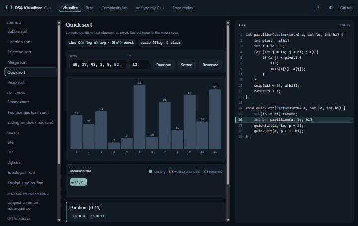

# DSA Visualizer (C++)

Watch 22 classic algorithms run **line by line next to real C++**, see how their cost grows with n, and analyze or trace **your own C++** right in the browser.

**Live:** https://dsa-visualizer-cpp.vercel.app



## Features

| | |
|---|---|
| **Visualize** | 22 algorithms with the current C++ line highlighted. Play/pause, step back and forth, scrub, change speed. |
| **Recursion tree** | Merge sort, quick sort, DFS and the tree traversals draw their call tree as they run. |
| **Quiz mode** | Click the line you think runs next; you get a score as you go. |
| **Editable graphs** | Add, drag and delete nodes; connect them; click a weight to change it; or generate a random graph. |
| **Shareable links** | "Share this step" copies a URL with the algorithm, your input and the exact step. |
| **Race** | Two sorts on the same input side by side, with live comparison and swap counts. |
| **Complexity lab** | Counts operations for six sorts from n = 10 to 4000 in the browser and fits O(n), O(n log n) or O(n²). |
| **Analyze my C++** | Paste two `solve()` functions. They're compiled with g++ 14 on [Judge0](https://judge0.com), timed on growing n, and fitted to a Big-O curve, and you get a verdict on which is faster. |
| **Trace replay** | `tracked_vector.hpp` logs every read, write, compare and swap with source line numbers. Run it in the browser (Judge0) or locally, then replay it. |

**Algorithms:** bubble, insertion, selection, merge, quick and heap sort · binary search, two pointers, sliding window · BFS, DFS, Dijkstra, topological sort (with cycle detection), Kruskal + union-find · LCS, 0/1 knapsack, LIS, edit distance · BST insert, inorder, preorder and postorder.

Light/dark/system theme, a first-visit intro, and a mobile layout with sticky controls.

## Run

```bash
npm install
npm run dev          # http://localhost:5173
npm run build        # production build in dist/
npm run check:cpp    # compile every C++ snippet shown in the UI with g++
npm run verify       # headless tests for every engine (add -- --online for the Judge0 tests)
```

Judge0: by default the site calls the free public instance at `ce.judge0.com` directly from the browser, with no key and no backend. To use your own instance, set `VITE_JUDGE0_URL`.

## Trace your own C++

```cpp
#include "tracked_vector.hpp"

TrackedVector<int> a = {5, 2, 9, 1};   // was: vector<int> a = {...};
bubbleSort(a);                          // your function takes TrackedVector<int>&
```

Paste that into **Trace replay → Run on Judge0**, or build it locally with `g++ -std=c++20 your.cpp && ./a.out`, which writes `trace.json`. See `cpp/examples/insertion_trace.cpp`.

Limits: elements must be arithmetic types, access must go through `operator[]` (no iterators or `std::sort`), and `auto x = a[i]` gives you a proxy, so write `int x = a[i]`.

## How it works

- Every C++ snippet in the UI is a real file in `src/cpp/` with `// @label` markers. Each JS engine mirrors its snippet step for step and records frames of (state, message, line). `check:cpp` compiles all 22 snippets.
- `verify` checks every engine against brute force on random inputs: sorts on 200 arrays each, binary search and two pointers on 300, the sliding window and LIS on 200, and Kruskal against Prim on 50 random graphs. It also covers cycle detection, URL round-trips and the replay. With `--online` it runs the analyzer harness and the browser-trace program on real Judge0, and checks that the online trace matches a local g++ run exactly.
- The analyzer harness doubles n until a ~6 s budget would run out, so an O(n²) solution stops early instead of timing out. `#line` directives keep compiler errors pointing at your own line numbers.

Before/after of the v2 upgrade: [docs/BEFORE-AFTER.md](docs/BEFORE-AFTER.md)
