# v1 → v2: before and after

**v1** (2026-11-19 morning): 15 algorithms, a complexity lab, and a trace replay that needed a local compiler.
**v2** (2026-11-19 evening): all 10 planned upgrades shipped.

| | Before (v1) | After (v2) |
|---|---|---|
| Algorithms | 15 | **22**: + binary search, two pointers, sliding window, topological sort, Kruskal + union-find, LIS, edit distance |
| Your own C++ | Only by tracing locally (download header, compile, upload JSON) | **Analyze my C++**: paste two solutions, which are compiled, timed and Big-O-fitted on Judge0. **Run on Judge0** traces in the browser. |
| Graphs | One fixed 8-node graph | **Editable**: add, drag and delete nodes and edges, click weights, random graph |
| Learning | Watch only | **Quiz mode**: predict the next line, with a score |
| Recursion | Call stack as text (DFS only) | **Recursion tree** for merge sort, quick sort, DFS and traversals |
| Comparing | Complexity lab charts only | **Race**: two sorts side by side, same input, live counters |
| Sharing | URL had only the algorithm name | **Share this step**: the URL holds algorithm + input + exact step, and reloads keep your input |
| Theme | Followed the OS only | **System / light / dark** toggle |
| First visit | Dropped straight in | **Intro** dialog (reopen with `?`) |
| Mobile | Basic stacking | Header actions beside the logo, scrollable tabs, **sticky controls**, larger tap targets |
| README | Text only | **Demo GIF** + **OG preview image** for link sharing |
| Tests | Sorts, sample graph, DP answers | + brute-force checks for all new engines, Kruskal vs Prim on 50 random graphs, URL round-trip, and **live Judge0** checks (analyzer fits, online trace equals local trace) |

## Visualize

| Before | After |
|---|---|
| 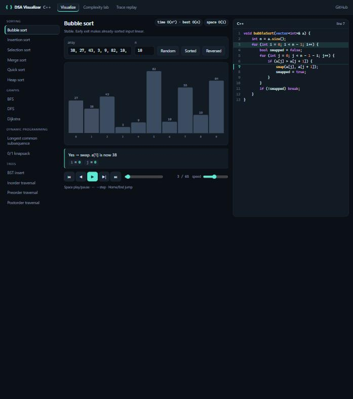 | 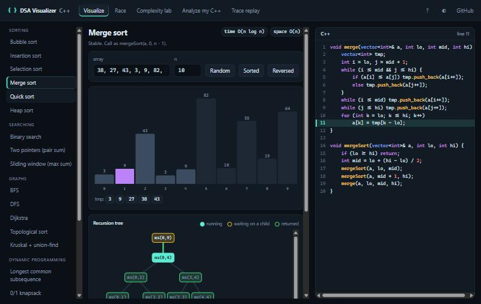 |
| Bars + code only | Recursion tree grows as merge sort runs (running / waiting / returned) |

## Graphs

| Before | After |
|---|---|
| 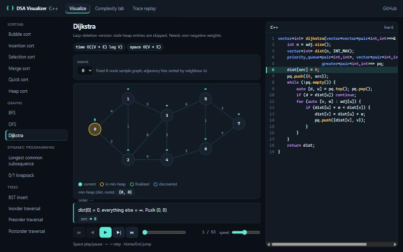 | 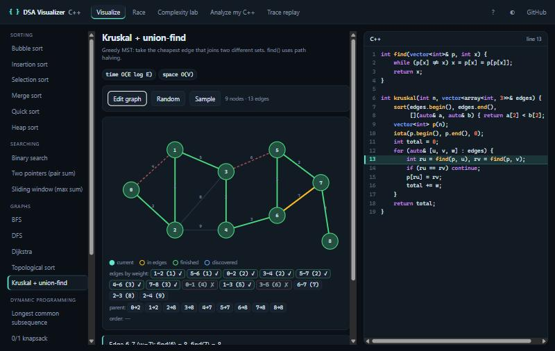 |
| Fixed graph; BFS, DFS, Dijkstra | Graph edited in the browser (node 8 added); Kruskal shows chosen ✓, rejected ✗ (dashed) and the union-find parent array |

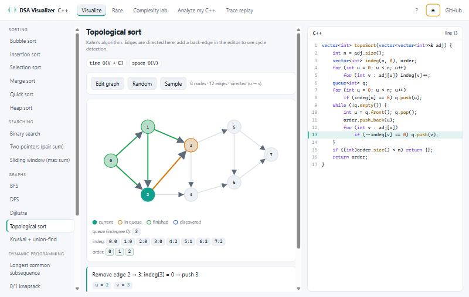
*New: topological sort with directed edges, shown in the new light theme.*

## Quiz mode (new)

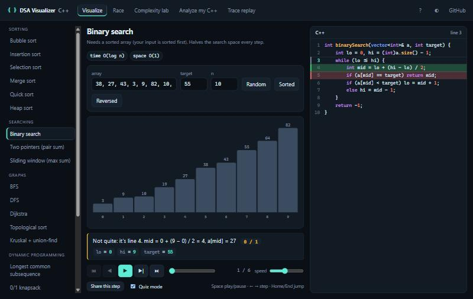

## Race (new)

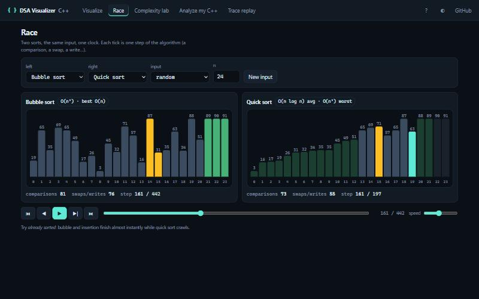

## Analyze my C++ (new)

| | |
|---|---|
| 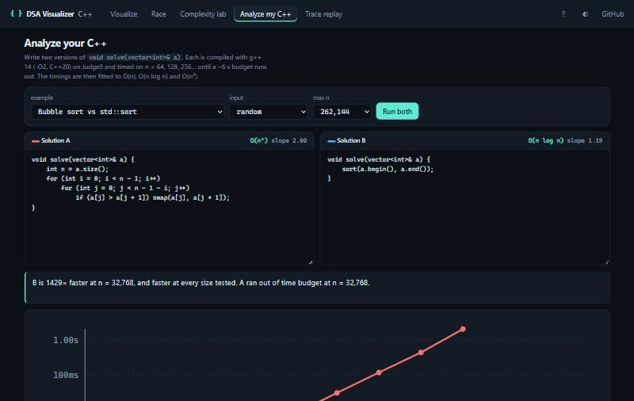 | 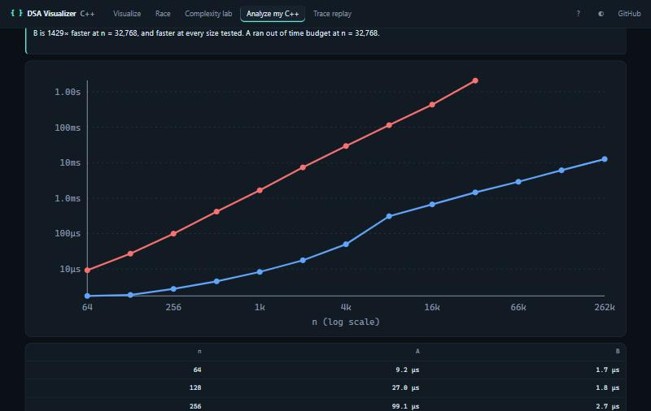 |

Live run: bubble sort fitted **O(n²)** (slope 2.00), `std::sort` fitted **O(n log n)** (slope 1.19), and `std::sort` was 1429× faster at n = 32,768.

## Trace replay

| Before | After |
|---|---|
| 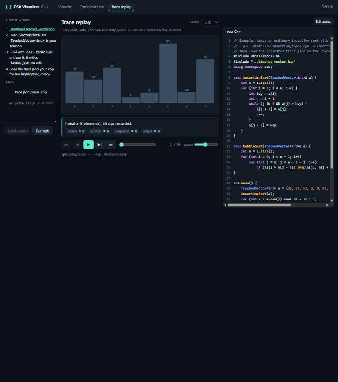 | 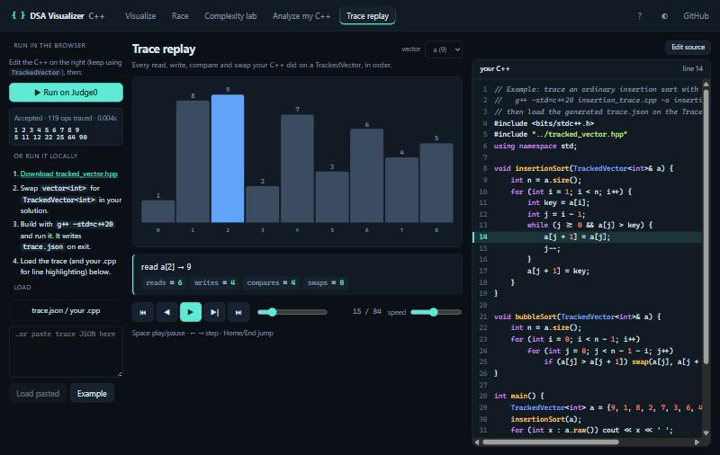 |
| Download header → compile locally → upload `trace.json` | Edit the C++ in the page → **Run on Judge0** → replay (119 ops, program output shown) |

## Complexity lab

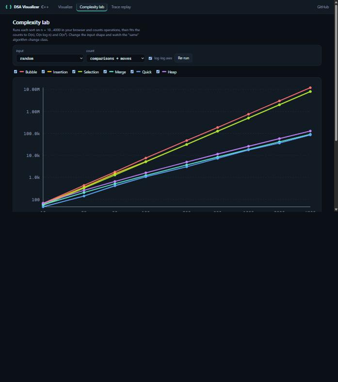
*Unchanged in v2. It still counts operations for 6 sorts and fits Big-O.*

## Intro and mobile (new)

| | |
|---|---|
| 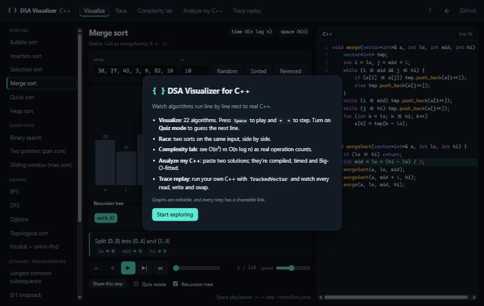 | 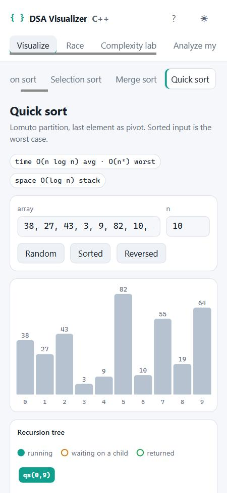 |
